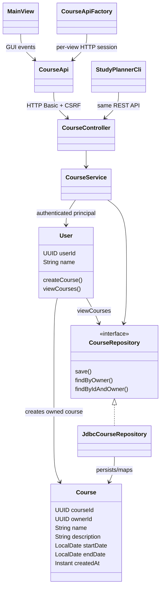
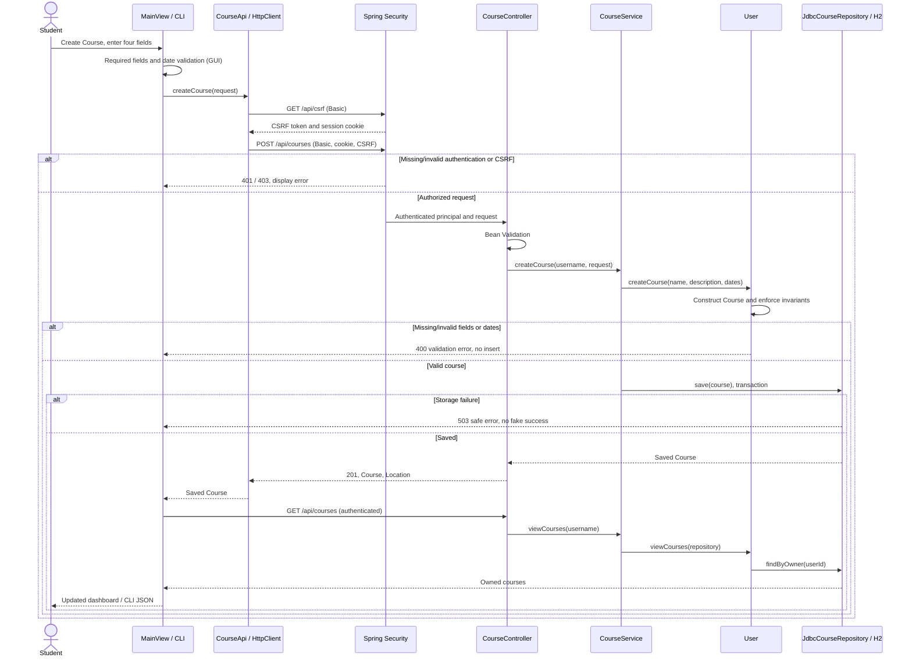
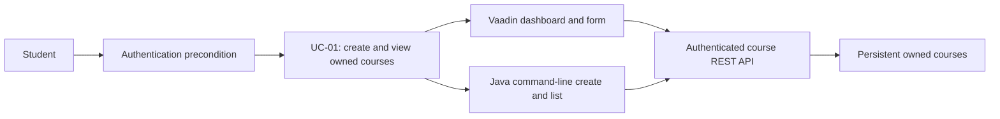

# Stage 2 — F01 implemented diagrams

These diagrams supplement the original UML/SD01. F02's upload branch is not yet implemented.

Changes from Stage 1: explicit HTTP client, security, service, and repository reflect
the separate runtime processes and durable storage. User.createCourse/viewCourses
remain meaningful domain operations. No AI design pattern is added for F01.
