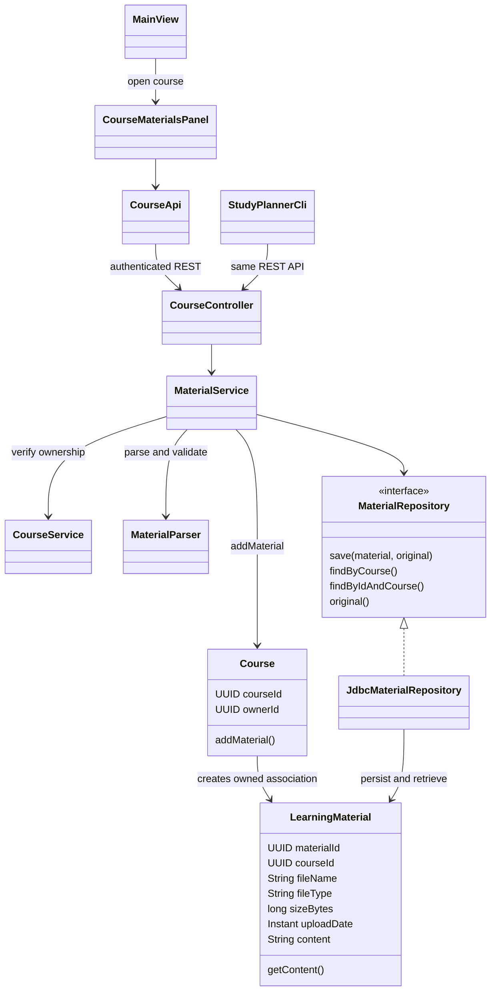
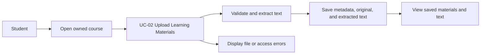

# Stage 2 - F02: Upload Learning Materials

References: F02, UC-02, SD01 upload branch, Stage 1 Course and LearningMaterial.
Original diagrams are preserved; this adds the actual client/service/storage layers.



```mermaid
sequenceDiagram
    actor Student
    participant UI as CourseMaterialsPanel / CLI
    participant Controller as CourseController
    participant Service as MaterialService
    participant Courses as CourseService
    participant Parser as MaterialParser
    participant Course
    participant DB as JdbcMaterialRepository / H2
    Student->>UI: Open course, select files
    UI->>Controller: Authenticated multipart POST with CSRF token
    Controller->>Service: uploadMaterial(username, courseId, files)
    Service->>Courses: getCourse(username, courseId)
    alt Course absent or belongs to another student
        Courses-->>UI: 404 error
    else Owned course
        loop Each file in request
            Service->>Parser: Check size/type, parse actual content
            alt Unsupported, empty, oversized, corrupt, encrypted, or unreadable
                Parser-->>UI: Safe 400/413/415 error; transaction rolls back
            else Readable file
                Parser-->>Service: Safe filename, canonical MIME type, extracted text
                Service->>Course: addMaterial(name, type, size, text)
                Course-->>Service: LearningMaterial
                Service->>DB: Save metadata, original BLOB, text CLOB
            end
        end
        DB-->>Controller: Saved metadata (transaction commits)
        Controller-->>UI: 201 and materials
        UI->>Controller: GET owned course materials
        Controller-->>UI: Material list
        UI-->>Student: Saved files with View text
    end
```



PDF, DOCX, and UTF-8 TXT are supported, up to 10 MiB per file and 10 files per request.
GUI files are separate requests; API/CLI batches roll back together on failure.
Text extraction is deterministic preparation for future AI features, not an LLM call.
