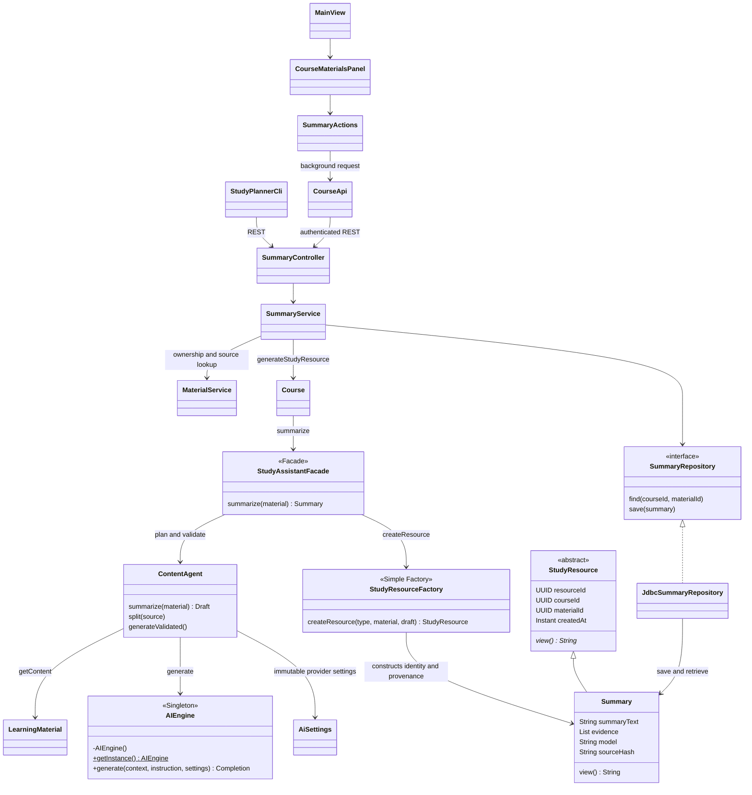
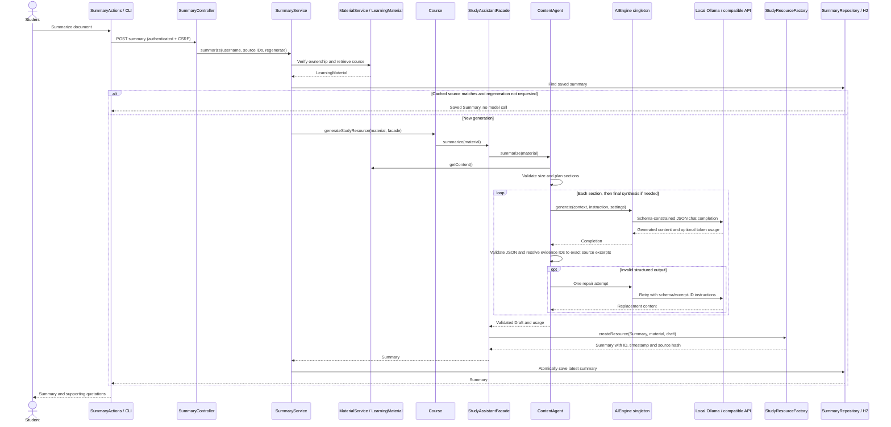

# Stage 2 - F03 Document Summarization

References: F03, UC-03, SD02 summary branch, Stage 1 Task 4 F03.
Only implemented classes and relationships are shown. Other resource products,
agents, Strategy and Observer are future work.

Invalid ownership, insufficient/oversized content, missing configuration, rate
limits, provider failures, malformed/ungrounded output and timeouts produce safe
errors. Failed regeneration preserves the previous saved summary.

Changes from Stage 1: ContentAgent adds bounded section planning, synthesis and
indexed source-excerpt validation. The model chooses excerpt IDs instead of
transcribing quotations; the backend resolves and verifies the exact source text.
AIEngine's static singleton shares connections/concurrency
limits while accepting immutable provider settings per call. The simple Factory
currently constructs only Summary; no unimplemented product is claimed. JDBC
adds persistent summary memory. Direct Java HTTP replaces the proposed LangChain
integration for this feature; retrieval/RAG for F05 remains future work.
