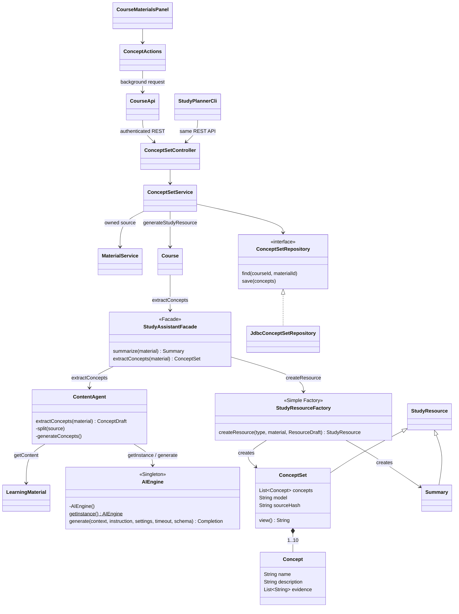

# Stage 2 — F04 Concept Extraction

References: Stage 1 F04, UC-04, Task 4 F04, UML-Diagram.uxf, and SD02 concept branch.
F03 remains available; the factory now creates two real resource products.



```mermaid
sequenceDiagram
    actor Student
    participant UI as ConceptActions / CLI
    participant Service as ConceptSetController / Service
    participant Course
    participant Facade as StudyAssistantFacade
    participant Agent as ContentAgent
    participant Material as LearningMaterial
    participant Engine as AIEngine singleton
    participant LLM as Local Ollama
    participant Factory as StudyResourceFactory
    participant DB as ConceptSetRepository / H2
    Student->>UI: Extract Concepts
    UI->>Service: POST materials/{id}/concepts (authenticated + CSRF)
    Service->>Service: Verify ownership and guard concurrent generation
    Service->>DB: Find latest source-matching ConceptSet
    alt Saved result and no explicit regeneration
        DB-->>Service: Cached ConceptSet
    else Generate
        Service->>Course: generateStudyResource("ConceptSet", material, facade)
        Course->>Facade: extractConcepts(material)
        Facade->>Agent: extractConcepts(material)
        Agent->>Material: getContent()
        Agent->>Agent: Validate size and plan source sections
        loop Each section, then consolidation for multi-section input
            Agent->>Engine: generate(context, extraction request, schema)
            Engine->>LLM: Chat completion with structured output
            LLM-->>Agent: Concepts with evidence IDs (via Engine)
            Agent->>Agent: Validate fields and source IDs, merge duplicate names and references
            opt Invalid output
                Agent->>Engine: One repair request; fail if still invalid
            end
        end
        Agent-->>Facade: Validated ConceptDraft
        Facade->>Factory: createResource("ConceptSet", material, draft)
        Factory-->>Service: ConceptSet (via Facade / Course)
        Service->>DB: Atomically replace latest set only after success
    end
    Service-->>UI: Concepts, explanations, source quotes, metadata
    UI-->>Student: Display concept list
```

UC-04 keeps its original actor, trigger, and success outcome. View saved concepts uses
GET; Regenerate concepts uses POST with `regenerate=true`. Both are limited to the
selected uploaded document; an uploaded section can be used as a separate material.
There is no new course-section management or whole-course extraction feature.

Changes from Stage 1: agent returns validated draft data before factory construction;
H2 stores the latest set with a source hash. Exact-name duplicates (Unicode-normalized,
case/punctuation/spacing-insensitive) are merged instead of failing the entire request.
The model is also asked to consolidate synonymous topics; semantic uniqueness is not
guaranteed. Invalid/empty responses, unsupported types, bad evidence IDs, insufficient
text, and provider errors fail without replacing saved results. Concept names may paraphrase the source; they are not required to occur literally in a quotation. Readable source sentences and long-sentence tails are available as evidence; dense lists use contiguous grouped windows. Repair includes the validation reason and a bounded previous response as untrusted user data. These checks verify quotation provenance, not semantic correctness.
The 40–32,000 character,
14-call, 180-second, and shared two-model-call limits match F03. Exact source quotations
do not prove the generated explanations correct; review remains necessary.

Patterns: existing Facade, Singleton, and Simple Factory. ConceptSet is the second
concrete StudyResource product. No additional distinct design pattern is claimed.
