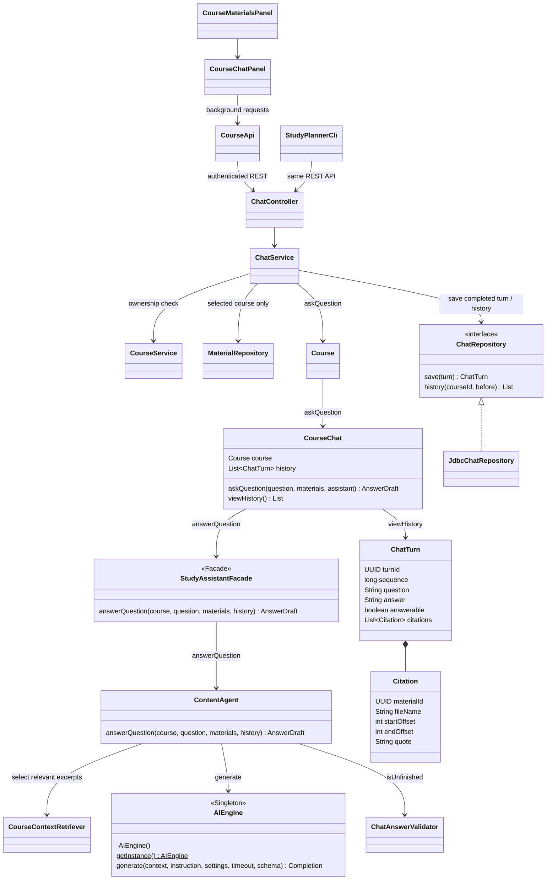
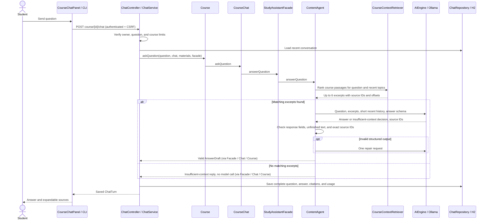

# Stage 2 — F05 Questions About Course Materials

References: Stage 1 F05, UC-05, Task 4 F05, UML-Diagram.uxf, and SD02 question branch.

UC-05 keeps its original course chat and saved-history outcome. CourseChat is an
immutable conversation snapshot; ChatService and the repository manage persistence.
The UML's plain String return is expanded to AnswerDraft/ChatTurn to carry citations,
the insufficient-context decision, and generation metadata.

Retrieval uses weighted word matches and common plural variants across all uploaded text in the selected course,
with a smaller contribution from two recent questions for related follow-ups. Prior exchanges are omitted for new topics and after an insufficient-context response. It selects up to
six passages of up to 700 characters with overlap. Broad requests such as "Tell me about this course" use representative passages spread across the uploaded materials, without requiring topic keywords. Vague retries can also request a course overview. This is lexical retrieval followed
by generation, without embeddings, LangChain, or external search. No material from
another course is supplied. Questions allow 1–1000 characters; a course supports up
to 50 materials and 1,000,000 extracted characters. Larger courses get an explicit error.
The provider receives at most two recent turns, with bounded question/answer excerpts. Generic follow-ups may use recent question topics; new unrelated topics must match the current question. For a specific question with no matching passages, the agent saves an insufficient-context reply with model=course-search, zero model calls, and zero tokens.

History pages contain up to 50 complete turns in chronological order; `before` selects
older turns. Failed generation saves nothing, and history remains readable without
the model. An insufficient-context response is saved as a normal exchange with no
citations. Each question has at most two provider calls, each using the configured
timeout (up to 120 seconds). Requests share AIEngine's two-call concurrency limit.

Patterns: the existing Facade and Singleton. Chat answers are not factory-created
study resources. Source-ID checks establish quotation provenance, not factual truth
or citation relevance. Lexical retrieval can miss synonyms or information outside
the selected passages; users can ask a more specific question and inspect source text.

Obvious unfinished answers (a dangling introduction or empty list item) receive the same single repair attempt as invalid JSON/source IDs. ChatAnswerValidator detects these cases without imposing a blanket minimum answer length; valid short answers remain allowed. Repeated failure saves no turn. This heuristic does not prove that every requested detail was answered.
