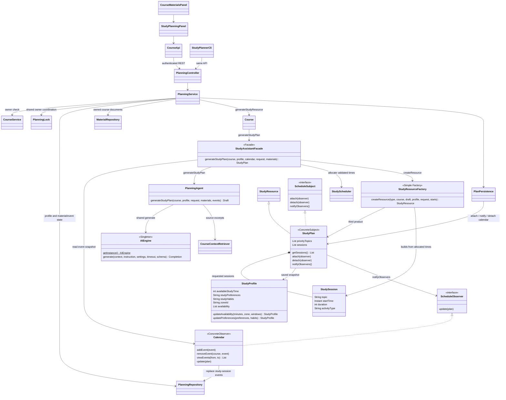

# Stage 2 — F06 Personalized Study Plans and UC-11 Study Profile

References: Stage 1 F06, UC-06, UC-11, SD03, and the original UML. Hybrid:
the LLM recommends priorities and activities; Java allocates all session times.



```mermaid
sequenceDiagram
    actor Student
    participant UI as StudyPlanningPanel / CLI
    participant Service as PlanningController / PlanningService
    participant Repo as PlanningRepository / H2
    participant Course
    participant Facade as StudyAssistantFacade
    participant Agent as PlanningAgent
    participant LLM as AIEngine / Ollama
    participant Scheduler as StudyScheduler
    participant Factory as StudyResourceFactory
    participant Plan as StudyPlan
    participant Calendar as Calendar observer
    Student->>UI: Save study profile / availability (UC-11)
    UI->>Service: PUT study-profile
    Service->>Repo: Save validated profile for authenticated owner
    Student->>UI: Add busy time or quiz/exam date
    UI->>Service: POST calendar-events
    Service->>Repo: Save owned event
    Student->>UI: Generate study plan (UC-06)
    UI->>Service: POST study-plan (dates, session count/duration, assessment notes)
    Service->>Service: Acquire owner planning lock; validate course and dates
    Service->>Repo: Read profile, course materials, and calendar
    Service->>Scheduler: Check requested capacity before model use
    Service->>Course: generateStudyResource(profile, calendar, request, materials, facade)
    Course->>Facade: generateStudyPlan
    Facade->>Agent: Recommend priorities and activities from source excerpts
    Agent->>LLM: Profile, notes, important dates, source IDs, and output schema
    LLM-->>Agent: Topics, priorities, activities, instructions, evidence IDs
    Agent->>Agent: Validate output; merge duplicate topics; one repair if needed
    Agent-->>Facade: Validated Draft
    Facade->>Scheduler: Allocate future times around conflicts and weekly budget
    Scheduler-->>Facade: Valid session start times
    Facade->>Factory: createResource(StudyPlan, draft, starts)
    Factory-->>Service: StudyPlan and StudySessions (via Facade / Course)
    rect rgb(235, 245, 235)
        Note over Service,Repo: Short database transaction; no transaction during model generation
        Service->>Repo: Save replacement plan
        Service->>Plan: attach(Calendar); notifyObservers()
        Plan->>Calendar: update(plan)
        Calendar->>Repo: Replace this course's generated study events
        Note over Service,Repo: Commit both changes, or roll back both on failure
    end
    Service-->>UI: Saved plan, sessions, and calendar data
    UI-->>Student: Priorities, instructions, dates, and source quotations
```

UC-11 allows a student to save weekly study minutes, non-overlapping weekly time
windows, preferences, habits, and an IANA time zone. The same profile is used across
their courses. Updating a profile or calendar affects the next generated plan;
the previous plan remains available until successfully replaced.

The plan request chooses 1–30 sessions of 15–180 minutes (15-minute increments),
over 1–56 days within the course dates and no earlier than today in the profile's
time zone. Sessions finish before the first upcoming quiz/exam in that period.
Scheduling avoids all the student's stored events and counts other courses' study
sessions against the same Monday–Sunday budget. Regeneration replaces the selected
course's old sessions. Times are stored as UTC instants and displayed in the profile
time zone; elapsed durations handle daylight-saving transitions.

Changes from Stage 1: availability is expressed as weekly windows and a minute
budget; StudyProfile updates return immutable values. The agent receives calendar
and material snapshots. Assessment results/weak areas can be entered as notes;
automatic quiz-result integration waits for F08/F09. No grades are fabricated.
The factory assembles sessions from the scheduler output rather than asking the StudyPlan constructor to derive times. StudyPlan is course-wide, so its inherited materialId is null; its topics/sessions
carry material citations. Calendar.update receives the changed plan as its event
payload. The Observer projection and latest plan are saved atomically in H2.

F10 is partially supported through event add/remove/list and plan synchronization.
The full calendar interface and Course/Quiz observer subjects remain future work.
F06 uses Facade, Singleton, Simple Factory, and Observer; Strategy remains pending.

Limits: 28 availability windows, 50 materials / 1,000,000 extracted characters per
course, six representative source excerpts, and two model calls including repair.
Recommendations may miss course topics or contain inaccurate advice despite valid
quotations. Slot allocation is deterministic; semantic recommendation quality still
requires review. Saved plans/profile/calendar can be viewed without a model.
