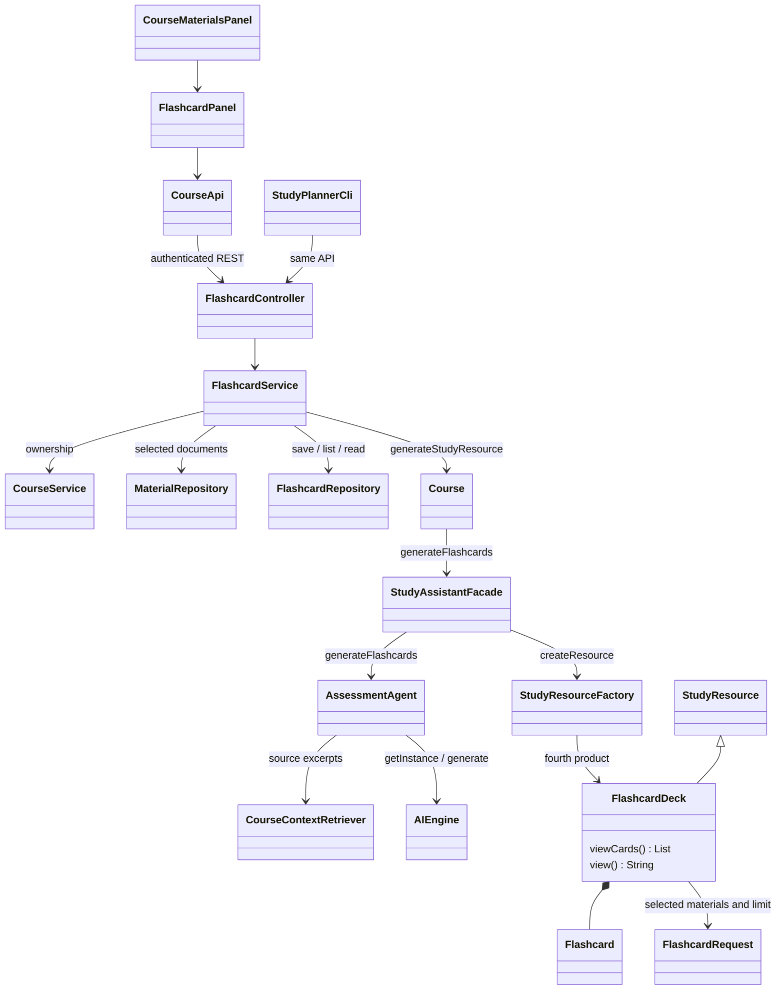

# Stage 2 — F07 Flashcard Generation

References: Stage 1 F07, UC-07, SD04 flashcard branch, Task 4 F07, and original UML.
UC-07's main scenario repeats study-plan text; F07 and SD04 define the flashcard behavior used here.



```mermaid
sequenceDiagram
    actor Student
    participant UI as GUI / CLI
    participant Service as FlashcardService
    participant Course
    participant Facade as StudyAssistantFacade
    participant Agent as AssessmentAgent
    participant Engine as AIEngine singleton
    participant Factory as StudyResourceFactory
    participant DB as FlashcardRepository / H2
    Student->>UI: Choose maximum, materials, optional topic
    UI->>Service: POST flashcards
    Service->>Service: Check owner, selected materials, size, generation lock
    Service->>Course: generateStudyResource(request, materials)
    Course->>Facade: generateFlashcards
    Facade->>Agent: generateFlashcards
    Agent->>Agent: Select real course excerpts
    loop Batches of up to three cards
        Agent->>Engine: generate(structured schema and source IDs)
        Engine-->>Agent: Model response
        Agent->>Agent: Validate cards, resolve source IDs, remove duplicates
        opt Invalid JSON, incomplete answer, or invalid reference
            Agent->>Engine: One correction with bounded previous output
            Engine-->>Agent: Replacement response
        end
    end
    Agent-->>Facade: Validated flashcard draft
    Facade->>Factory: createResource("FlashcardDeck", draft)
    Factory-->>Facade: FlashcardDeck
    Facade-->>Course: Deck
    Course-->>Service: Deck
    Service->>DB: Save complete deck
    Service-->>UI: Deck (viewCards through JSON getter)
    UI-->>Student: Question; click to reveal answer and sources
    Student->>UI: Open saved deck
    UI->>DB: Owner-checked service read; no model call
```

F07 reuses **Facade**, **Singleton**, and **Simple Factory**. AssessmentAgent is now
implemented; FlashcardDeck is the fourth factory product. Observer is not needed for decks.

The maximum is 1–20 cards; fewer are allowed instead of padding. Material selection
limits source documents; an optional topic narrows passage retrieval. A separately
uploaded section can be selected as a material. Dedicated course-section management
is not added. Retrieval uses at most six 700-character excerpts, so a deck is not a
complete review of every uploaded page.

Selected files must belong to the course (up to 50, 1,000,000 extracted characters).
Each batch gets one repair; generation is bounded to 40 model calls and 180 seconds.
Answers accept short facts. Only validated cards are saved, including a smaller deck when later generation fails. Errors never remove existing decks. Exact source quotations prove provenance, not factual correctness.
Saved decks are immutable snapshots and may become outdated when course content changes.

H2 `flashcard_decks` stores full JSON and history metadata. History pages contain 25
decks with a stable sequence cursor. Every read checks ownership; writes also need
CSRF. GUI requests use the bounded executor. CLI commands: `flashcards`, `decks`, `deck`.

F07 answers must appear in a cited excerpt (case and repeated whitespace are ignored).
The AI writes the question and selects the answer; unsupported answers get one repair
attempt, then are skipped; a response with no valid cards saves nothing. Questions and citation relevance still need review.

F07 count fix: short batches no longer end generation. Each new batch receives unused
source answers; repeated questions/answers are removed. Generation continues toward
the maximum until answers are exhausted or two batches add no cards (40 calls /
180 seconds maximum). A smaller saved deck shows an explanation. Restart both apps
and generate a new deck to apply this behavior to existing courses.

If a multi-card batch still fails after repair, the agent switches to single-card
requests. Source attribution is corrected by matching the selected answer against
the original excerpts; unknown IDs and answers absent from all sources still fail.
