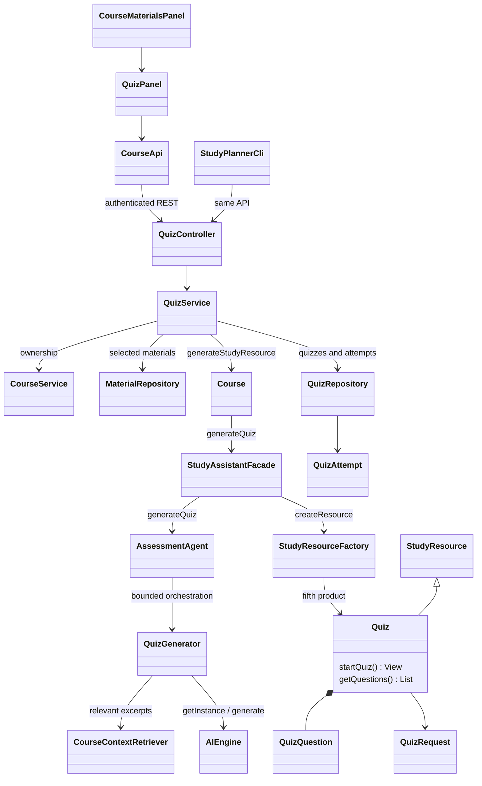

# Stage 2 — F08 Quiz Generation

References: Stage 1 F08, UC-08, SD04 quiz branch, Task 4 F08, and original UML.
F08 generates and stores quizzes and attempts. F09 now adds automatic scoring and feedback.



```mermaid
sequenceDiagram
    actor Student
    participant UI as GUI / CLI
    participant Service as QuizService
    participant Course
    participant Facade as StudyAssistantFacade
    participant Agent as AssessmentAgent / QuizGenerator
    participant Engine as AIEngine singleton
    participant Factory as StudyResourceFactory
    participant DB as QuizRepository / H2
    Student->>UI: Count, difficulty, topics, materials, preferred types
    UI->>Service: Generate quiz
    Service->>Service: Ownership, input, material limits, generation lock
    Service->>Course: generateStudyResource
    Course->>Facade: generateQuiz
    Facade->>Agent: generateQuiz
    Agent->>Agent: Select passages and distinct source facts
    loop One question per source fact
        Agent->>Engine: Source fact, difficulty, type, earlier keys/questions
        Engine-->>Agent: Exact missing phrase and optional distractors
        Agent->>Agent: Match unique whole phrase; construct blank; validate and shuffle choices
        opt Invalid output
            Agent->>Engine: One repair with bounded untrusted previous output
            Engine-->>Agent: Corrected phrase and distractors
        end
    end
    alt Exact requested count is valid
        Agent-->>Facade: Typed quiz draft
        Facade->>Factory: createResource("Quiz")
        Factory-->>Service: Quiz via Facade and Course
        Service->>DB: Save full quiz and private answer key
        Service-->>UI: Quiz.startQuiz public view
    else Invalid or insufficient output
        Service-->>UI: Error; earlier quizzes unchanged
    end
    Student->>UI: Start, answer, save draft, resume, finish
    UI->>Service: Owned attempt request with version
    Service->>DB: Save responses using version check
    Service-->>UI: Draft hides key; finished attempt permits answer review
```

The planned **Facade**, **Singleton**, and **Simple Factory** roles are reused.
QuizGenerator is AssessmentAgent's helper, not an additional design pattern. Quiz
extends StudyResource. Its immutable request stores difficulty/count/topic settings.
Quiz.startQuiz supplies the public questions used by the API and attempt view.

The form accepts 1–20 questions, EASY/MEDIUM/HARD, optional topic text (500 characters),
and optional SHORT_ANSWER/MULTIPLE_CHOICE preferences. Empty types default to short
answer. Selected uploaded files represent course sections; dedicated section management
is not added. Mixed types alternate in the requested order. Quiz count is exact; a
short or invalid result saves no quiz. This differs from F07's maximum-card setting.

Each question targets a distinct source sentence/phrase. The AI selects a meaningful missing phrase and, for multiple choice, three distractors. Java supplies the source-backed correct
answer, resolves the citation, and shuffles four choices. Structured checks reject
empty/duplicate choices, copied correct-answer distractors, and repeated questions.
Difficulty, relevance, ambiguity, and semantic correctness still require human review.
No fake questions or fallback answer keys are generated.

Limits: 50 selected materials / 1,000,000 extracted characters, six 700-character
excerpts, 40 model calls / 180 seconds. Each fact gets one repair; unusable facts are skipped within the overall call/time budget. Invalid generation preserves older quizzes and attempts.

H2 adds quizzes and quiz_attempts. Quiz history uses stable pages of 25. The latest
25 attempts for a quiz are available for reopening. Drafts store full response maps;
optimistic versions prevent silent overwrites from another window. A finish requires
all answers, freezes that attempt, and exposes its answer key and quotations. Ordinary
quiz/start/draft responses omit the key. Every operation checks ownership; writes need
CSRF. F09 now adds scoring, feedback, Strategy, and Quiz.submitQuiz grading orchestration;
see stage2-f09.md. Quiz calendar dates remain F10.

F08 uses source-based fill-in-the-blank questions for both supported types. The AI
selects the removed phrase and MCQ distractors; Java constructs the stem from the
original fact. Restoring the expected phrase must reproduce the source statement.
This avoids mismatched generated questions/keys. Difficulty guides which phrase
is removed; semantic difficulty and distractor ambiguity still need review.

Ten-question recovery fix: the model selects from up to 48 prevalidated source
phrases per fact. The agent continues past failed facts within the 40-call/180-second
budget and allows an answer term to recur in different question contexts. Identical
question stems remain rejected. Failures report the valid count; no incomplete quiz
is saved. Regressions cover failures in the first three facts and repeated terms.
