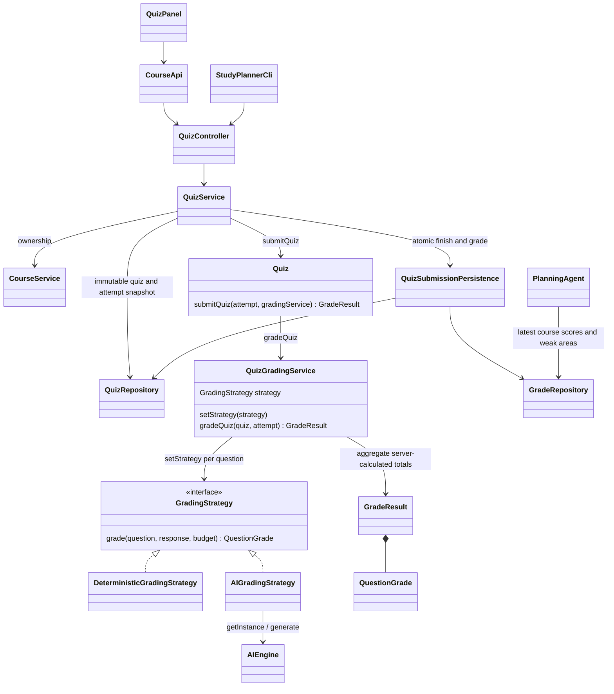

# Stage 2 — F09 Automatic Quiz Grading

References: Stage 1 F09, UC-09, SD05, Task 4 F09, and original UML.



```mermaid
sequenceDiagram
    actor Student
    participant UI as GUI / CLI
    participant Service as QuizService
    participant Quiz
    participant Grading as QuizGradingService (new context)
    participant Rule as DeterministicGradingStrategy
    participant AI as AIGradingStrategy
    participant Engine as AIEngine singleton
    participant Store as QuizSubmissionPersistence
    participant DB as H2 repositories
    Student->>UI: Submit quiz for grading
    UI->>Service: Responses and attempt version
    Service->>Service: Ownership, complete answers, version, attempt lock
    Service->>Quiz: submitQuiz(attempt, grading context)
    Quiz->>Grading: gradeQuiz
    Grading->>Grading: Validate all keys, points, and source criteria before AI
    loop Every question
        alt Objective choice (including binary choices)
            Grading->>Grading: setStrategy(deterministic)
            Grading->>Rule: grade
            Rule-->>Grading: Full or zero credit, feedback, weak area
        else Short answer
            Grading->>Grading: setStrategy(AI)
            Grading->>AI: grade
            alt Match after case, punctuation, NFC and whitespace normalization
                AI-->>Grading: Full credit without a model call
            else Semantic evaluation needed
                AI->>Engine: Source, key, rubric, untrusted student response
                Engine-->>AI: Categorical verdict and reason code
                AI->>AI: Validate; one correction if needed
                AI-->>Grading: Validated question grade or error
            end
        end
    end
    Grading-->>Quiz: GradeResult with server-calculated totals
    Quiz-->>Service: GradeResult
    Service->>Store: Finish attempt and store result
    Store->>DB: Version-checked update and grade insert in one transaction
    Service-->>UI: Saved score, feedback, weak areas, answer review
    UI-->>Student: Display results
```

**Strategy** is now the fifth planned pattern. The context is a Spring prototype,
created through ObjectProvider for each grading operation. setStrategy really
switches its strategy field per question; concurrent submissions never share that
mutable context. Strategies are stateless components. AIEngine retains Singleton.
GradeResult is created by the grading service as in SD05, not by the resource factory.

MCQs use deterministic full/zero marks. The same strategy handles two-choice True/False
criteria when present; F08 currently generates short answers and four-choice MCQs.
Short answers use exact matching first, then AI evaluation when needed. Exact matching
ignores case and final sentence punctuation, normalizes NFC and whitespace, and requires no provider. Semantic
grading accepts equivalent wording in context and can award 0, 0.5, or 1 of the stored
question points. Java computes weighted totals and percentage; the model cannot set
the quiz total. The server supplies the rubric and saved answer keys, not the client.

AI returns only a verdict and a reason code. Java builds feedback and one review fact
from the saved answer key and source statement, so the model cannot invent a correction.
Limits are one repair per question, 40 model calls, and 180 seconds per operation. Failed
grading returns an error, leaves the saved attempt/version unchanged, and keeps form
answers available for saving/retry. No partial grade or guessed fallback score is saved.
Model judgments may be wrong; results identify AI-assisted marks and retain sources.

New submissions save finished responses and quiz_grades together. Storage failure
rolls back both. Reopening a result or grading an already graded attempt uses the
saved GradeResult without another AI call. Older F08 finished attempts can be graded
once through the same strategies. Finished responses and saved grades are immutable;
students can start another attempt to retry. Every route checks course ownership;
POST actions require CSRF. Competing writes to one attempt return 409.

Quiz still owns questions; QuizAttempt owns one set of submitted responses. This
extends the Stage 1 model to preserve retakes. GradeResult stores per-question marks,
feedback, aggregate weak areas, timestamps, model identity, and reported token/call
usage (-1 means unavailable). Failed calls are not included in saved-result usage.

PlanningAgent now reads the latest graded attempt for each of up to five recent
quizzes in the selected course. Scores and weak areas guide the next generated plan;
grading does not silently change an existing schedule. Manual assessment notes remain
available. F10's full calendar view and Course/Quiz schedule subjects remain pending.
